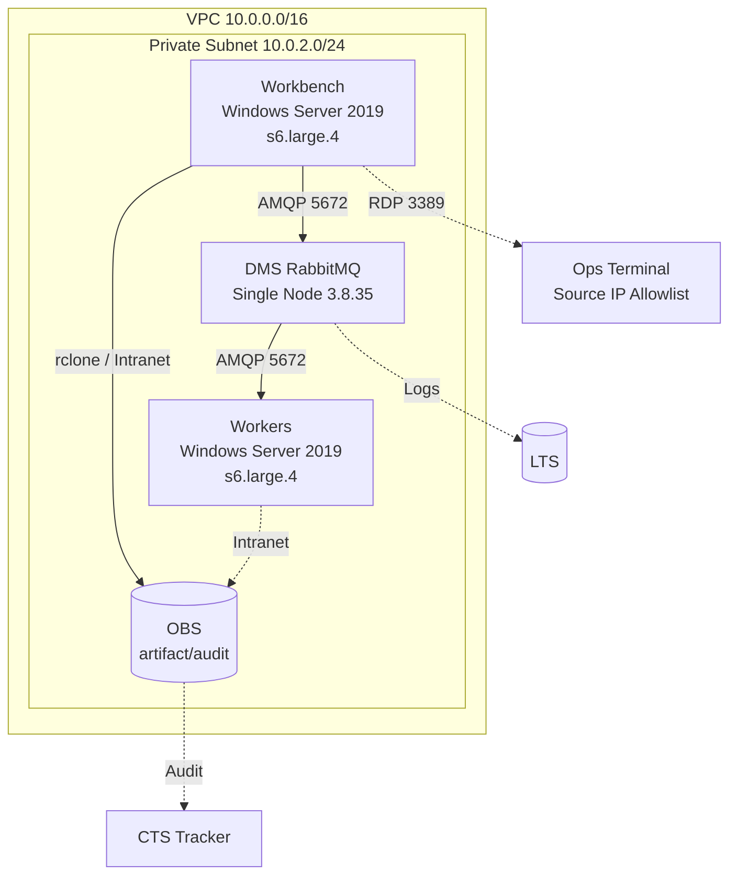

# Automotive Software Developer Workbench on Huawei Cloud

[](LICENSE)


[](LICENSE)
[](https://www.huaweicloud.com)

## 1. Overview

A one-click deployable working environment for automotive software developers, built on Huawei Cloud: a **Developer Workbench** and **Build/Simulation Nodes (Workers)**, with built-in **Distributed Message Service (DMS) for RabbitMQ**, **Object Storage Service (OBS)**, **Cloud Trace Service (CTS)**, **Log Tank Service (LTS)**, and **Data Encryption Workshop (DEW)**. It is suitable for ECU software development, build, and verification scenarios for automotive software R&D teams.

## Table of Contents

- [1. Overview](#1-overview)
- [2. Table of Contents](#2-table-of-contents)
- [3. Architecture Diagram](#3-architecture-diagram)
- [4. Key Features](#4-key-features)
- [5. Huawei Cloud Services Used](#5-huawei-cloud-services-used)
- [6. Prerequisites](#6-prerequisites)
- [7. Quick Start](#7-quick-start)
- [8. Step-by-Step Deployment](#8-step-by-step-deployment)
- [9. Usage](#9-usage)
- [10. Cleanup](#10-cleanup)
- [11. Detailed Description](#11-detailed-description)
- [12. Dependencies](#12-dependencies)
- [13. FAQ / Troubleshooting](#13-faq--troubleshooting)
- [14. Contributing](#14-contributing)
- [15. License](#15-license)
- [16. Contact](#16-contact)

## 3. Architecture Diagram



- The Workbench provides a Remote Desktop (RDP) entry via an **Elastic IP (EIP)**; the security group only allows the ops source IP.
- The Workbench and Workers communicate with DMS RabbitMQ over the VPC intranet. Workers are pure intranet nodes (no public IP).
- The OBS intranet endpoint carries workspace synchronization and audit log archiving, generating no public network traffic.

## 4. Key Features

- **Pure intranet architecture**: Workers have no public IP; OBS and DMS are accessed over the VPC intranet, minimizing the attack surface.
- **One-click teardown**: After verification, `terraform destroy` cleans up all resources.
- **Infrastructure as Code (IaC)**: Fully declared with Terraform — reproducible, auditable, and version-controllable.
- **Secure by default**: Audit (CTS), logs (LTS), credential management (DEW), source IP allowlist security group, and Windows password injection-based management.

## 5. Huawei Cloud Services Used

| Huawei Cloud Service | Purpose |
|--------|------|
| ECS (Workbench / Workers) | Windows workbench and build nodes |
| EVS system disk | System disk |
| EIP | Workbench RDP entry |
| DMS for RabbitMQ | Message communication |
| OBS / LTS / CTS / DEW | Storage, logs, audit, credentials |
| CodeArts (optional) | Pipeline skeleton, disabled by default |

## 6. Prerequisites

- A Huawei Cloud account with permissions to provision ECS, VPC, DMS, OBS, and related services in the target region (default `cn-north-4`).
- Access keys: pass via `TF_VAR_*` on the deploy command (**do not write them into any file**):

  ```bash
  export HW_ACCESS_KEY="<HW_ACCESS_KEY>"
  export HW_SECRET_KEY="<HW_SECRET_KEY>"
  export HW_REGION_NAME="cn-north-4"
  ```

- Terraform ≥ 1.9 (huaweicloud provider ≥ 1.60).
- Region constraint: In `cn-north-4`, the public image for Windows Server is **2019** (no 2022 public image available in this region yet). Controlled by the `windows_os_version` variable.

## 7. Quick Start

```bash
cd infra

# 1. Initialize (download the huaweicloud provider)
terraform init

# 2. Preview changes
terraform plan -var 'windows_admin_password=<your-password>' -var 'rabbitmq_password=<your-password>'

# 3. Deploy
terraform apply -var 'windows_admin_password=<your-password>' -var 'rabbitmq_password=<your-password>'
```

> ⚠️ Before deploying, change the default value `0.0.0.0/0` of `admin_source_cidr` in `variables.tf` to your fixed egress IP, to avoid exposing RDP to the entire internet.
> For production or long-running use, inject the password via `TF_VAR_*` or `-var`; do not use the default value.

## 8. Step-by-Step Deployment

See [`docs/deployment-guide.md`](docs/deployment-guide.md) for complete, reproducible deployment steps. Summary:

```bash
cd infra
terraform init
terraform plan -var 'windows_admin_password=<your-password>' -var 'rabbitmq_password=<your-password>'
terraform apply -var 'windows_admin_password=<your-password>' -var 'rabbitmq_password=<your-password>'
```

- `terraform init` downloads the huaweicloud provider;
- `terraform plan` previews changes; expected output `Plan: 24 to add, 0 to change, 0 to destroy`;
- `terraform apply` completes with `Apply complete! Resources: 24 added`;
- Optional image factory: see Section 4 of `docs/deployment-guide.md` (build a Windows private image with Packer).

> ⚠️ Before deploying, tighten the default `0.0.0.0/0` of `admin_source_cidr` in `variables.tf` to your fixed egress IP (the RDP entry security group only allows the ops source IP).

## 9. Usage

### 1. Log in to the Workbench via Remote Desktop

```text
mstsc /v:<workbench_eip>:3389
User: Administrator
Password: windows_admin_password injected at deploy time (hint available via terraform output workbench_rdp_hint)
```

### 2. Verify the message queue end-to-end (Workbench → RabbitMQ produce/consume)

Run in the Workbench cmd (RabbitMQ management API; successful authentication proves intranet connectivity and a healthy instance):

```bash
# 2.1 Check instance status (returns JSON = pass)
curl -u <rabbit_user>:<rabbit_password> "http://<rabbitmq_host>:15672/api/overview"

# 2.2 Create queue → publish message → consume message (three-step loop)
curl -u <rabbit_user>:<rabbit_password> -X PUT "http://<rabbitmq_host>:15672/api/queues/%2F/workbench_demo" -H "Content-Type: application/json" -d "{\"durable\":false}"
curl -u <rabbit_user>:<rabbit_password> -X POST "http://<rabbitmq_host>:15672/api/exchanges/%2F/amq.default/publish" -H "Content-Type: application/json" -d "{\"properties\":{},\"routing_key\":\"workbench_demo\",\"payload\":\"hello from workbench\",\"payload_encoding\":\"string\"}"
curl -u <rabbit_user>:<rabbit_password> -X POST "http://<rabbitmq_host>:15672/api/queues/%2F/workbench_demo/get" -H "Content-Type: application/json" -d "{\"count\":5,\"ackmode\":\"ack_requeue_false\",\"encoding\":\"auto\"}"
```

> `routed:true` means the message was enqueued successfully; the consume step passing back the original payload is the verification pass.
> The Workbench/Workers private IPs and the RabbitMQ intranet address are available via `terraform output`.

## 10. Cleanup

```bash
cd infra
terraform destroy
```

> Deletes all resources (ECS/EIP/DMS/OBS/VPC, etc.). The OBS bucket is set with `force_destroy=true` and can be deleted directly.

## 11. Detailed Description

### Workflow

1. Developers log in to the Workbench via Remote Desktop (RDP) for local software development/modeling.
2. The workspace is synchronized to OBS (the `artifact` bucket) via tools such as rclone over the VPC intranet endpoint.
3. The Workbench and Workers exchange build tasks and result messages through DMS RabbitMQ.
4. CTS archives audit logs to the OBS `audit` bucket; LTS collects runtime logs; DEW manages connection credentials.

### Key Configuration Items (`infra/variables.tf`)

| Variable | Default | Description |
|------|--------|------|
| `region` | `cn-north-4` | Deployment region |
| `project_name` | `automotive-workbench` | Resource naming prefix |
| `admin_source_cidr` | `0.0.0.0/0` ⚠️ | Source IP allowlist for RDP/SSH; **must be tightened before deployment** |
| `worker_instance_type` / `workbench_instance_type` | `s6.large.4` | ECS flavor |
| `windows_os_version` | `2019` | Windows public image version |
| `codearts_enabled` | `false` | Whether to create a CodeArts pipeline (requires the CodeArts service enabled on the account first) |
| `windows_admin_password` / `rabbitmq_password` | placeholder | Sensitive; recommend runtime injection |

### Directory Structure

```
infra/     Terraform project (all infrastructure declarations)
packer/    Image factory template (optional; build a base Windows private image with Packer)
docs/      Architecture description and deployment guide
```

## 12. Dependencies

### Main Dependencies

- **Terraform** ≥ 1.9 and **huaweicloud provider** ≥ 1.60: Infrastructure as Code declarations and resource orchestration.
- **Packer** and Huawei Cloud's official `huaweicloud-ecs` builder plugin: build Windows private images (optional).
- **Huawei Cloud services**: ECS, VPC, EIP, DMS for RabbitMQ, OBS, LTS, CTS, DEW, IAM agency, CodeArts (optional).

## 13. FAQ / Troubleshooting

- **CodeArts reports `PM.02100546 The enterprise tenant service is disabled`**: The account has not enabled the CodeArts/ProjectMan service. Enable it in the console first, then set `codearts_enabled=true` and re-apply.
- **DMS creation reports `DMS.00400009 Product not found`**: The flavor must be auto-matched by region via the `huaweicloud_dms_product` data source; do not hand-write the flavor ID.
- **Cannot find the Windows 2022 public image**: In `cn-north-4`, the latest public image is Windows Server 2019; adjust `windows_os_version`.
- **RDP cannot connect**: Confirm the security group `admin_source_cidr` includes your egress IP; wait 3–5 minutes after instance creation for initialization to complete.

## 14. Contributing

Issues, suggestions, and improvements are welcome via the repository's Issue tracker. Please read the project's contribution guidelines before submitting. PRs involving infrastructure changes must attach `terraform validate` and `terraform plan` results.

## 15. License

This project is published under the **MIT No Attribution** license (see `LICENSE`).

- Modification date: 2026-08-19
- Modification: All infrastructure implemented with Huawei Cloud Terraform (`infra/`); added a Packer image factory (`packer/`).
- License is MIT No Attribution, with no copyleft obligation.

## 16. Contact

| Item | Content |
|------|---------|
| **Creator** | dgc-git |
| **Maintainer** | Deng Guicai |
| Communication channel | Submit issues, suggestions, or improvements via the repository's Issue tracker |
