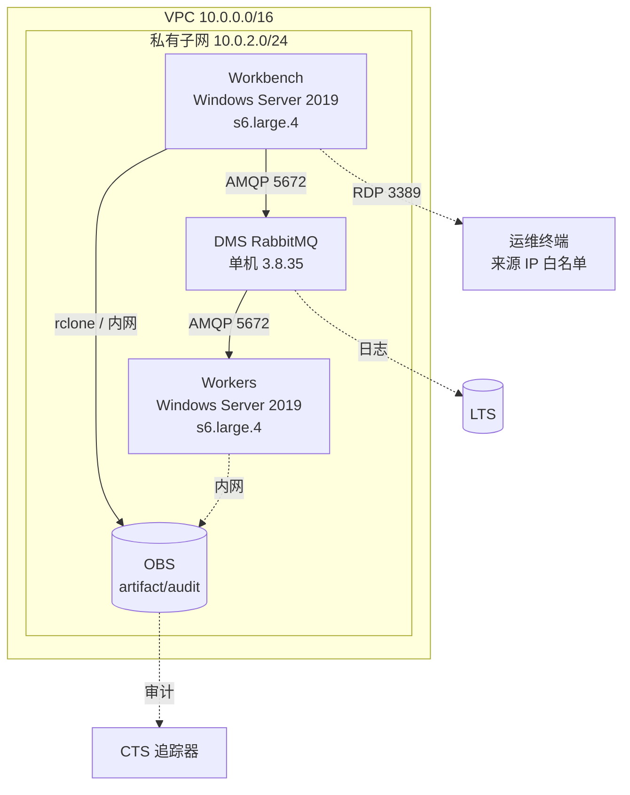

# Automotive Software Developer Workbench on Huawei Cloud

[](LICENSE)


[](LICENSE)
[](https://www.huaweicloud.com)

## 1. 简介

为汽车软件开发者提供的一键部署工作环境：基于华为云构建 **开发者工作台（Workbench）** 与 **构建/仿真节点（Workers）**，
内置消息队列（DMS RabbitMQ）、对象存储（OBS）、审计（CTS）、日志（LTS）与凭据托管（DEW）。
适用于汽车软件研发团队的 ECU 软件开发、构建与验证场景。

## 目录

- [1. 简介](#1-简介)
- [2. 目录](#2-目录)
- [3. 架构图](#3-架构图)
- [4. 方案亮点](#4-方案亮点)
- [5. 涉及云服务](#5-涉及云服务)
- [6. 前置条件](#6-前置条件)
- [7. 快速开始](#7-快速开始)
- [8. 分步部署](#8-分步部署)
- [9. 使用方法](#9-使用方法)
- [10. 清理资源](#10-清理资源)
- [11. 详细说明](#11-详细说明)
- [12. 依赖](#12-依赖)
- [13. FAQ / 故障排除](#13-faq--故障排除)
- [14. 贡献指南](#14-贡献指南)
- [15. 许可证](#15-许可证)
- [16. 联系方式](#16-联系方式)

## 3. 架构图



- Workbench 通过**弹性公网 IP（EIP）**提供 RDP 远程桌面入口，安全组仅放行运维来源 IP。
- Workbench 与 Workers 通过 VPC 内网直连 DMS RabbitMQ 通信，Workers 为纯内网节点（无公网 IP）。
- OBS 内网 endpoint 承载工作区同步与审计日志归档，不产生公网流量。

## 4. 方案亮点

- **纯内网架构**：Workers 无公网 IP，OBS / DMS 均走 VPC 内网访问，攻击面小。
- **一键销毁**：验证完 `terraform destroy` 即清理全部资源。
- **基础设施即代码**：Terraform 全量声明，可复现、可审计、可版本化。
- **安全默认项**：审计（CTS）、日志（LTS）、凭据托管（DEW）、来源 IP 白名单安全组、Windows 密码注入式管理。

## 5. 涉及云服务

| 云服务 | 用途 |
|--------|------|
| ECS（Workbench / Workers） | Windows 工作台与构建节点 |
| EVS 系统盘 | 系统盘 |
| EIP | Workbench RDP 入口 |
| DMS RabbitMQ | 消息通信 |
| OBS / LTS / CTS / DEW | 存储、日志、审计、凭据 |
| CodeArts（可选） | 流水线骨架，默认关闭 |

## 6. 前置条件

- 华为云账号，且目标区域（默认 `cn-north-4`）有 ECS、VPC、DMS、OBS 等服务的开通权限。
- 访问密钥：通过 `TF_VAR_*` 在部署命令中传入（**请勿将密钥写入任何文件**）：

  ```bash
  export HW_ACCESS_KEY="<HW_ACCESS_KEY>"
  export HW_SECRET_KEY="<HW_SECRET_KEY>"
  export HW_REGION_NAME="cn-north-4"
  ```

- Terraform ≥ 1.9（huaweicloud provider ≥ 1.60）。
- 区域约束：`cn-north-4` 公共镜像的 Windows Server 版本为 **2019**（该区域暂无 2022 公共镜像），已由 `windows_os_version` 变量控制。

## 7. 快速开始

```bash
cd infra

# 1. 初始化（下载 huaweicloud provider）
terraform init

# 2. 预览变更
terraform plan -var 'windows_admin_password=<你的密码>' -var 'rabbitmq_password=<你的密码>'

# 3. 部署
terraform apply -var 'windows_admin_password=<你的密码>' -var 'rabbitmq_password=<你的密码>'
```

> ⚠️ 部署前请务必把 `variables.tf` 中 `admin_source_cidr` 的默认值 `0.0.0.0/0` 改为你的固定出口 IP，避免 RDP 对全网开放。
> 生产/长时间使用请改用 `TF_VAR_*` 或 `-var` 注入密码，勿使用默认值。

## 8. 分步部署

完整、可复现的部署步骤见 [`docs/deployment-guide.md`](docs/deployment-guide.md)。摘要如下：

```bash
cd infra
terraform init
terraform plan -var 'windows_admin_password=<你的密码>' -var 'rabbitmq_password=<你的密码>'
terraform apply -var 'windows_admin_password=<你的密码>' -var 'rabbitmq_password=<你的密码>'
```

- `terraform init` 下载 huaweicloud provider；
- `terraform plan` 预览变更，预期 `Plan: 24 to add, 0 to change, 0 to destroy`；
- `terraform apply` 完成后提示 `Apply complete! Resources: 24 added`；
- 可选镜像工厂：见 `docs/deployment-guide.md` 第 4 节（Packer 制作 Windows 私有镜像）。

> ⚠️ 部署前请务必将 `variables.tf` 中 `admin_source_cidr` 默认值 `0.0.0.0/0` 收紧为你的固定出口 IP（RDP 入口安全组仅放行运维来源 IP）。

## 9. 使用方法

### 1. 远程桌面登录 Workbench

```text
mstsc /v:<workbench_eip>:3389
用户：Administrator
密码：部署时注入的 windows_admin_password（terraform output workbench_rdp_hint 可查看提示）
```

### 2. 验证消息队列端到端（Workbench → RabbitMQ 生产/消费）

在 Workbench 的 cmd 中执行（RabbitMQ 管理 API，认证通过即证明内网连通与实例正常）：

```bash
# 2.1 查看实例状态（返回 JSON 即通过）
curl -u <rabbit_user>:<rabbit_password> "http://<rabbitmq_host>:15672/api/overview"

# 2.2 建队列 → 发消息 → 取消息（三步闭环）
curl -u <rabbit_user>:<rabbit_password> -X PUT "http://<rabbitmq_host>:15672/api/queues/%2F/workbench_demo" -H "Content-Type: application/json" -d "{\"durable\":false}"
curl -u <rabbit_user>:<rabbit_password> -X POST "http://<rabbitmq_host>:15672/api/exchanges/%2F/amq.default/publish" -H "Content-Type: application/json" -d "{\"properties\":{},\"routing_key\":\"workbench_demo\",\"payload\":\"hello from workbench\",\"payload_encoding\":\"string\"}"
curl -u <rabbit_user>:<rabbit_password> -X POST "http://<rabbitmq_host>:15672/api/queues/%2F/workbench_demo/get" -H "Content-Type: application/json" -d "{\"count\":5,\"ackmode\":\"ack_requeue_false\",\"encoding\":\"auto\"}"
```

> `routed:true` 表示消息成功入队；取消息步骤能回读原始 payload 即验证通过。
> Workbench/Workers 的私有 IP 与 RabbitMQ 内网地址可通过 `terraform output` 查看。

## 10. 清理资源

```bash
cd infra
terraform destroy
```

> 删除全部资源（ECS/EIP/DMS/OBS/VPC 等）。OBS 桶已设 `force_destroy=true`，可直接删除。

## 11. 详细说明

### 工作流程

1. 开发者通过 RDP 登录 Workbench，在本地进行软件开发/建模。
2. 工作区通过 rclone 等工具同步至 OBS（`artifact` 桶，VPC 内网 endpoint）。
3. Workbench 与 Workers 通过 DMS RabbitMQ 交换构建任务与结果消息。
4. CTS 将审计日志归档至 OBS `audit` 桶；LTS 承接运行日志；DEW 托管连接凭据。

### 关键配置项（`infra/variables.tf`）

| 变量 | 默认值 | 说明 |
|------|--------|------|
| `region` | `cn-north-4` | 部署区域 |
| `project_name` | `automotive-workbench` | 资源命名前缀 |
| `admin_source_cidr` | `0.0.0.0/0` ⚠️ | RDP/SSH 来源 IP 白名单，**部署前必须收紧** |
| `worker_instance_type` / `workbench_instance_type` | `s6.large.4` | ECS 规格 |
| `windows_os_version` | `2019` | Windows 公共镜像版本 |
| `codearts_enabled` | `false` | 是否创建 CodeArts 流水线（需账号先开通 CodeArts 服务） |
| `windows_admin_password` / `rabbitmq_password` | 占位 | 敏感项，建议运行时注入 |

### 目录结构

```
infra/     Terraform 工程（全部基础设施声明）
packer/    镜像工厂模板（可选，用 Packer 制作基础 Windows 私有镜像）
docs/      架构说明与部署指导书
```

## 12. 依赖

### 主要依赖

- **Terraform** ≥ 1.9 与 **huaweicloud provider** ≥ 1.60：基础设施即代码声明与资源编排。
- **Packer** 及华为云官方 `huaweicloud-ecs` builder 插件：制作 Windows 私有镜像（可选）。
- **华为云服务**：ECS、VPC、EIP、DMS RabbitMQ、OBS、LTS、CTS、DEW、IAM 委托、CodeArts（可选）。

## 13. FAQ / 故障排除

- **CodeArts 报 `PM.02100546 该企业租户服务处于关闭状态`**：账号未开通 CodeArts/ProjectMan 服务，需先在控制台开通，再置 `codearts_enabled=true` 重新 apply。
- **DMS 创建报 `DMS.00400009 Product not found`**：规格须通过 `huaweicloud_dms_product` 数据源按区域自动匹配，勿手写规格 ID。
- **找不到 Windows 2022 公共镜像**：`cn-north-4` 区域最新公共镜像为 Windows Server 2019，调整 `windows_os_version` 即可。
- **RDP 连不上**：确认安全组 `admin_source_cidr` 包含你的出口 IP；实例刚创建时等待 3-5 分钟完成初始化。

## 14. 贡献指南

欢迎通过仓库 Issue 提交问题、建议或改进。提交前请阅读项目贡献规范；涉及基础设施变更的 PR 须附 `terraform validate` 与 `terraform plan` 结果。

## 15. 许可证

本项目以 **MIT No Attribution** 许可证发布（见 `LICENSE`）。

- 修改日期：2026-08-19
- 修改内容：以华为云 Terraform（`infra/`）实现全部基础设施，新增 Packer 镜像工厂（`packer/`）。
- 许可证为 MIT No Attribution，无 copyleft 负担。

## 16. 联系方式

| 项目 | 内容 |
|------|------|
| **创建者** | dgc-git |
| **维护者** | dgc-git |
| 交流渠道 | 通过仓库 Issue 提交问题、建议或改进 |
