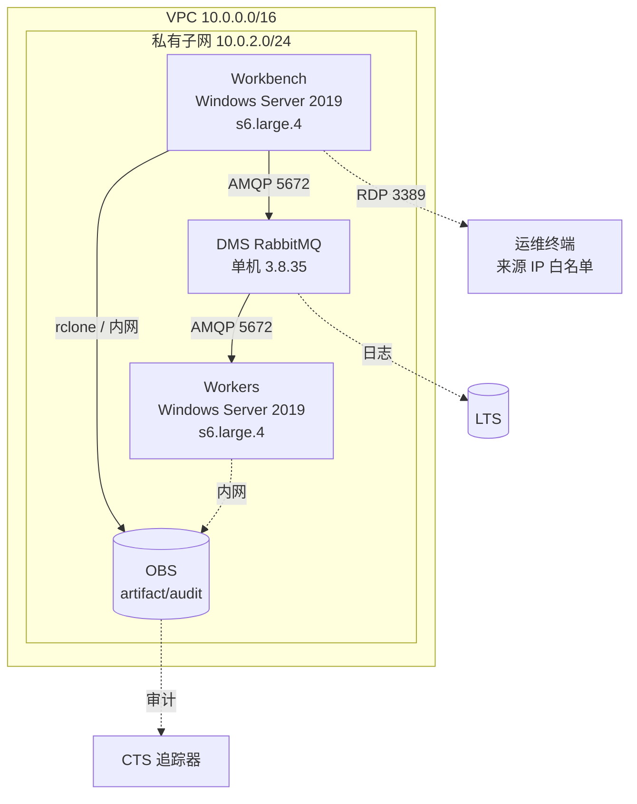

# 架构说明：Automotive Software Developer Workbench on Huawei Cloud

> 本文档阐述本实践在华为云上的目标架构与关键设计决策，供部署与运维参考。

## 1. 概述

本实践面向汽车软件研发团队，提供一套可一键部署的开发者工作环境，包含开发者工作台、构建/仿真节点、消息队列、对象存储与可观测/审计能力。整体采用基础设施即代码（Terraform）声明，可复现、可审计、可版本化。

核心组成：

| 组成 | 说明 |
|------|------|
| 开发者工作台（Workbench） | Windows Server ECS，经弹性公网 IP（EIP）提供 RDP 远程桌面入口，供开发者进行软件开发与建模 |
| 构建 / 仿真节点（Workers） | 纯内网 Windows Server ECS，承接构建与验证任务，无公网 IP |
| 消息队列 | DMS RabbitMQ（单节点）承担 Workbench 与 Workers 之间的任务分发与结果回传 |
| 对象存储 | OBS 存放工作区产物与审计归档，VPC 内网 endpoint 访问 |
| 日志与审计 | LTS 承接运行日志；CTS 追踪器将审计日志投递至 OBS |
| 凭据托管 | DEW（csms）托管消息队列连接凭据 |
| 镜像工厂（可选） | Packer 基于华为云官方插件制作 Windows 私有镜像 |
| 软件工厂（可选） | CodeArts 流水线骨架（默认关闭） |

## 2. 架构图

- Workbench 通过**弹性公网 IP（EIP）**提供 RDP 远程桌面入口，安全组仅放行运维来源 IP。
- Workbench 与 Workers 通过 VPC 内网直连 DMS RabbitMQ 通信；Workers 为纯内网节点（无公网 IP）。
- OBS 内网 endpoint 承载工作区同步与审计日志归档，不产生公网流量。

## 3. 安全模型

- **缩小攻击面**：Workers 无公网 IP；OBS / DMS 均走 VPC 内网访问。
- **入口收敛**：RDP 入口安全组仅放行运维来源 IP，部署前须将 `admin_source_cidr` 默认值 `0.0.0.0/0` 收紧为固定出口 IP。
- **凭据不落盘**：Windows / 消息队列密码经环境变量（`TF_VAR_*` 或 `-var`）注入，不写入任何文件；连接凭据由 DEW 托管。
- **默认安全**：审计（CTS）、日志（LTS）、凭据托管（DEW）默认开启。

## 4. 关键设计决策

### 4.1 远程访问方式

Workbench 采用「弹性公网 IP + 原生 RDP」方式提供远程桌面。该方式在华为云 ECS Windows 上原生支持，访问入口受安全组来源 IP 限制，连接可控。

### 4.2 去公网 NAT

OBS 与 DMS 均走 VPC 内网 endpoint，Workers 无出网需求，因此未部署公网 NAT 网关，架构更简单、暴露面更小。

### 4.3 镜像工厂

Packer 模板（`packer/`）基于华为云官方维护的 `huaweicloud-ecs` builder 将 Windows 公共镜像制作成私有镜像。该流程用于产出可复用的基础 Windows 私有镜像，构建步骤（provisioner）可按实际工具链追加。

> 说明：示例中的 Windows 镜像仅交付基础系统；特定行业工具链若与指定账号绑定、无法在本平台直接使用，需由对应供应商提供华为云侧镜像后，在模板中追加 provisioner 补装。

### 4.4 软件工厂（可选）

CodeArts 提供流水线骨架（`codearts_enabled` 默认 `false`）。账号需先在控制台开通 CodeArts 服务后，方可置 `true` 再次 apply；构建步骤当前为占位骨架，接入实际代码仓后补全。

## 5. 资源清单（逻辑）

| 类别 | 资源 |
|------|------|
| 网络 | VPC、私有子网、安全组及规则、Workbench 弹性公网 IP |
| 计算 | Workbench ECS、Workers ECS（Windows Server 2019） |
| 中间件 | DMS RabbitMQ 单节点实例 |
| 存储 | OBS 产物桶、OBS 审计桶 |
| 可观测 | LTS 日志组/日志流、CTS 追踪器 |
| 安全 | IAM 委托（ECS 访问 OBS）、DEW 凭据 |
| 可选 | CodeArts 项目/构建任务/流水线（默认关闭） |

## 6. 区域约束

- 默认区域 `cn-north-4`。
- 该区域公共镜像最新 Windows Server 版本为 **2019**（暂无 2022），由 `windows_os_version` 变量控制，可按区域调整。
- DMS RabbitMQ 规格须通过 `huaweicloud_dms_product` 数据源按区域自动匹配，避免手写规格 ID 导致创建失败。
